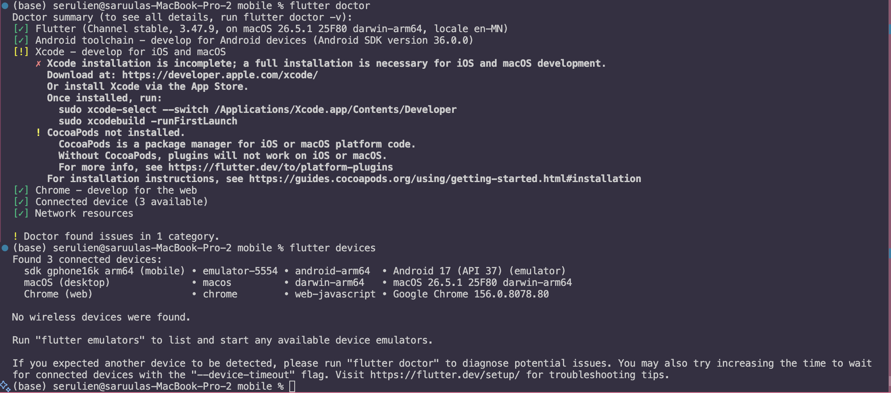
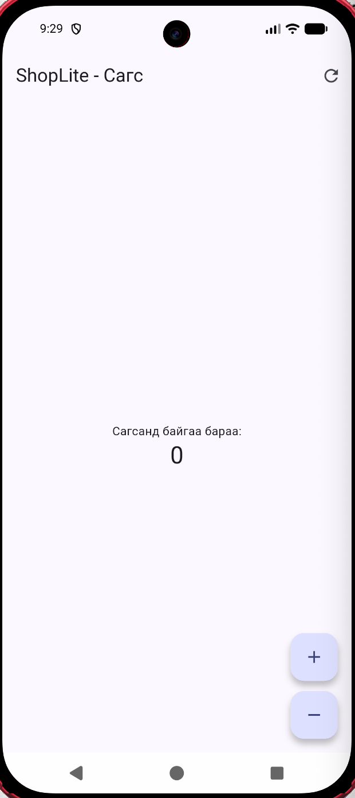

# ShopLite — Мобайл апп хөгжүүлэлт (Flutter)

**Нэр:** Ц. Саруулчимэг
**Оюутны код:** 23B1NUM1396

Энэ репозиторид 6 долоо хоногийн турш бүх лабораторийн кодоо хадгална.

```
├── README.md          ← энэ файл (доорх хэсгүүдийг бөглөнө)
├── screenshots/       ← дэлгэцийн зураг
├── lab1_dart/         ← Лаборатори 1: Dart дасгал
└── shoplite/          ← Лаборатори 1-д `flutter create`-оор үүсгэнэ
```

## Код хадгалах (лаборатори бүрийн төгсгөлд)

```bash
git add .
git commit -m "Lab 1: Dart модель, shoplite апп"
git push
git tag v0.1            # Лаб 1 → v0.1, Лаб 2 → v0.2, ...
git push origin v0.1
```

Push хийсний дараа GitHub дээрх **Actions** табаас автомат тестийн үр дүнг (ногоон ✓ / улаан ✗) харна.
`lab1_dart/test/` болон `.github/` хавтасны файлуудыг **өөрчлөхгүй**.

---

## Лаборатори 1




### lab1_dart

- `dart test test/lab1_test.dart`: 26 / 26
- Бонус B1 (`dart test test/bonus_test.dart`): хийсэн

### D2. Төслийн бүтэц

1. `lib/main.dart`-д ямар классууд байна? Аль нь StatelessWidget, аль нь StatefulWidget вэ?
   > MyApp нь StatelessWidget. Аппын үндсэн MaterialApp-ийг үүсгэж, гарчиг, өнгөний загвар болон эхний дэлгэцийг тохируулдаг.
   > MyHomePage нь StatefulWidget. Энэ нь тоолууртай дэлгэцийг төлөөлж, createState()-аар _MyHomePageState объектыг үүсгэдэг.
   > _MyHomePageState нь State<MyHomePage> класс. Тоолуурын одоогийн утгыг хадгалж, + товч дарахад утгыг нэмдэг. Утгыг setState() дотор өөрчилснөөр Flutter дэлгэцийг дахин зурж, шинэ тоог харуулна.
2. `pubspec.yaml`-д ямар сангууд байна?
   > dependencies хэсэгт flutter болон cupertino_icons байна. flutter нь MaterialApp, Scaffold, Text зэрэг widget-ийг ашиглах үндсэн сан. cupertino_icons нь iOS загварын дүрснүүдийг өгдөг. dev_dependencies хэсэгт flutter_test болон flutter_lints байна. flutter_test-ээр widget-ийг дэлгэцэд гаргаж, товч дарахад тоолуур өөрчлөгдөж байгаа эсэхийг тестэлж болно. flutter_lints нь dart analyze ажиллуулах үед кодын хэв маяг болон нийтлэг асуудлыг шалгах дүрмүүдийг өгдөг.
3. `android/` хавтас юунд хэрэгтэй вэ? Та ихэвчлэн аль хавтсанд код бичих вэ?
   > android/ хавтас нь Flutter аппыг Android дээр бүтээж ажиллуулахад хэрэгтэй. Дотор нь build хийх Gradle тохиргоо, Android-д аппын мэдээллийг зарлах AndroidManifest.xml, Flutter дэлгэцийг нээх MainActivity, мөн аппын дүрс зэрэг файлууд бий. ShopLite-ийн дэлгэц, товч, тоолуурын логикийг ихэвчлэн lib/ хавтаст Dart хэлээр бичнэ. Энэ лабораторийн D3 өөрчлөлтүүдийг lib/main.dart дээр хийнэ.

### D4. Hot reload ба hot restart

Туршилт бүрийг тоолуурын утгыг **3** болгож эхлүүлсэн.

| Өөрчлөлт | Hot reload (r) | Hot restart (R) |
|---|---|---|
| AppBar-ийн гарчгийг өөрчлөх | Шинэ гарчиг харагдаж, тоолуур **3** хэвээр үлдсэн. | Шинэ гарчиг харагдаж, тоолуур **0** болсон. |
| Seed өнгийг солих | Аппын өнгө солигдож, тоолуур **3** хэвээр үлдсэн. | Шинэ өнгө харагдаж, тоолуур **0** болсон. |
| `int _count = 0;` → `= 5` | Тоолуурын одоогийн утга **3** хэвээр үлдсэн. | Тоолуур шинээр үүсэж, шинэ анхны утга болох **5**-ыг авсан. |
| `main()` дотор `print('start');` нэмэх | Terminal дээр `start` хэвлэгдээгүй. Тоолуур **3** хэвээр үлдсэн. | `main()` дахин ажиллаж, Terminal дээр `start` хэвлэгдсэн. Тоолуур **0** болсон. |

**Дүгнэлт.** Hot reload нь одоо байгаа `State` объектыг хадгалж, дэлгэцийг шинэчилдэг тул тоолуурын утга **3** хэвээр үлдсэн. Hot restart нь `main()`-аас дахин эхэлж, `State` объектыг шинээр үүсгэдэг тул тоолуур кодод заасан анхны утга болох **0** эсвэл **5** руу орсон.